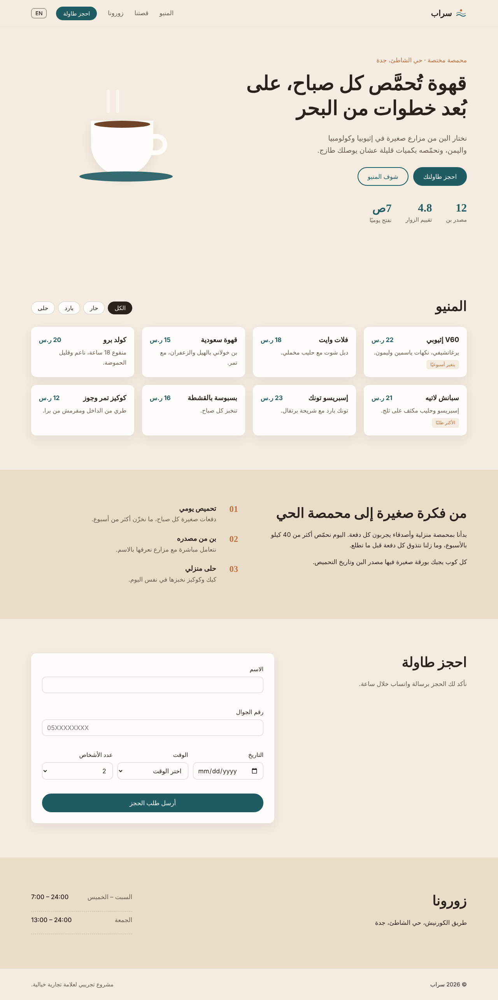

# Saraab Roastery

Landing page for a coffee roastery in Jeddah (fictional brand, made for my portfolio).
Arabic by default with an English toggle.

**Live:** https://areejalabbasi.github.io/saraab-rostery/



### Features
- Arabic / English switch, flips RTL/LTR and remembers your choice
- Menu with category filters
- Booking form with validation (Saudi mobile numbers, no past dates, Friday opens at 1pm)
- Responsive, with a mobile menu

### Built with
HTML, CSS and vanilla JavaScript. No framework, no build step.

### Run it
Just open `index.html`, or:
```
python3 -m http.server
```

### TODO
- send bookings to WhatsApp
- real photos + map
